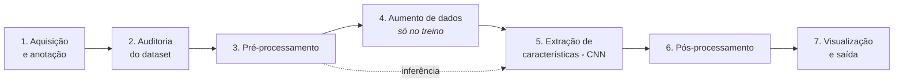
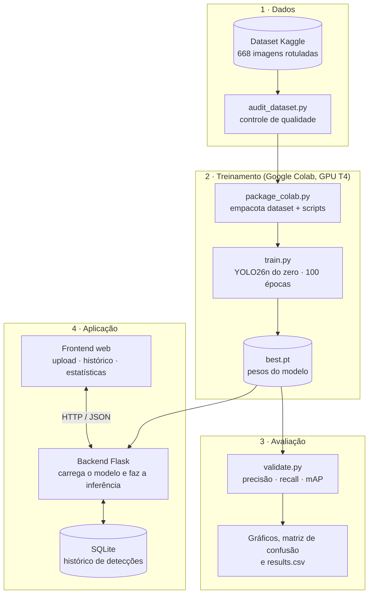
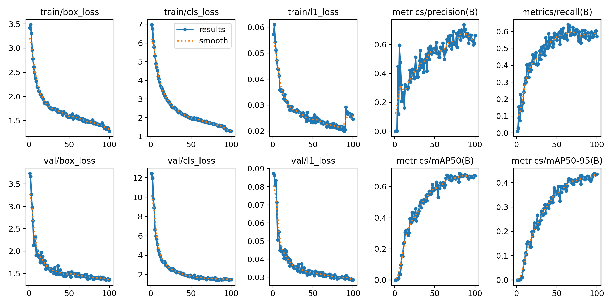
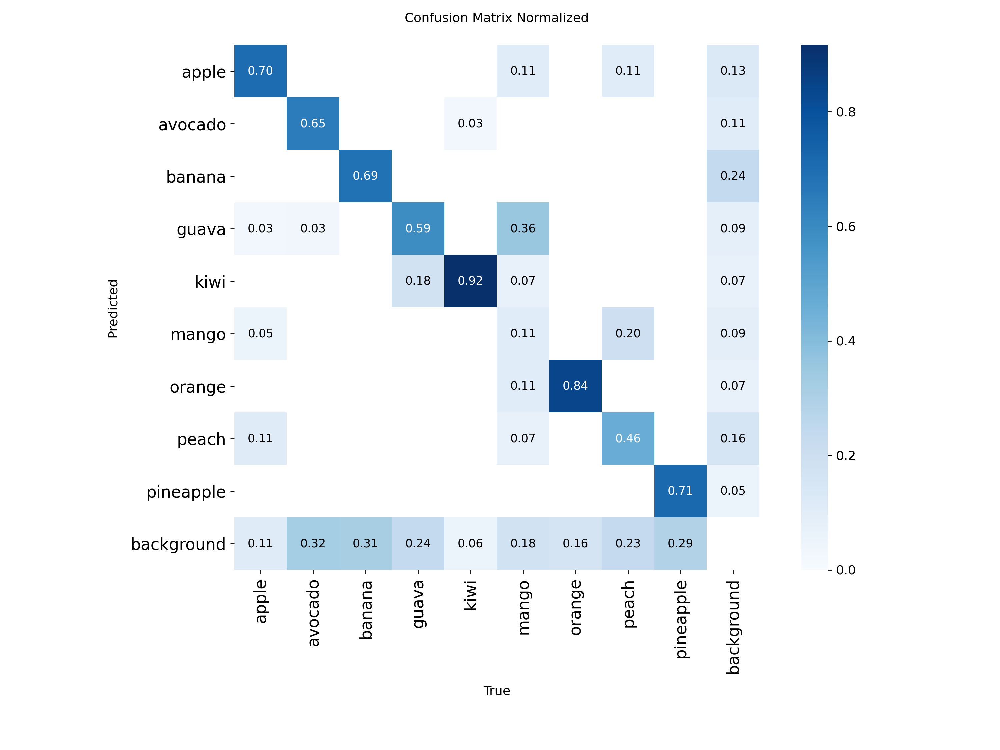

# FruitVision

Sistema de **detecção de frutas em imagens** usando visão computacional e deep
learning. O usuário envia uma foto e o sistema localiza cada fruta com uma caixa
delimitadora, informa a espécie e a confiança da detecção, e guarda o histórico
das análises.

O detector é uma rede neural convolucional **YOLO26n treinada do zero** pela
equipe, sem pesos pré-treinados e sem nenhuma API de IA externa.

## Sumário

- [Equipe](#equipe)
- [Dataset](#dataset)
- [Pipeline de processamento de imagens](#pipeline-de-processamento-de-imagens)
- [Integração com a disciplina de Inteligência Artificial](#integração-com-a-disciplina-de-inteligência-artificial)
- [Resultados](#resultados)
- [Requisitos](#requisitos)
- [Como executar](#como-executar)
- [Estrutura do repositório](#estrutura-do-repositório)

---

## Equipe

| Integrantes |
|---|
| Luiz Guilherme Tiritan Martins |
| Pedro Guermandi Bressan |
| Gustavo Messa Corbe |

---

## Dataset

**Fonte:** [Fruit Detection YOLO (Kaggle)](https://www.kaggle.com/datasets/itsmeaman03/fruit-detection-yolo)

O dataset está incluído neste repositório em [`dataset/`](dataset/), já no
formato usado pelo treinamento.

| Item | Valor |
|---|---|
| Classes | 9: `apple`, `avocado`, `banana`, `guava`, `kiwi`, `mango`, `orange`, `peach`, `pineapple` |
| Imagens | 668 (534 de treino e 134 de validação, divisão ≈ 80/20) |
| Objetos anotados | 1.647 caixas (1.336 no treino e 311 na validação) |
| Formato das imagens | JPG / JPEG |
| Formato das anotações | YOLO (um `.txt` por imagem) |

Cada linha de anotação descreve uma fruta:

```
<classe> <x_centro> <y_centro> <largura> <altura>
```

As coordenadas são **normalizadas entre 0 e 1** em relação ao tamanho da
imagem, o que torna a anotação independente da resolução. Exemplo real
(`labels/train/apple_1.txt`):

```
0 0.5069 0.5841 0.9366 0.8317
```

Distribuição de objetos por classe (saída de `training/audit_dataset.py`):

| Classe | Treino | Validação |
|---|---:|---:|
| apple (maçã) | 171 | 37 |
| avocado (abacate) | 196 | 34 |
| banana | 152 | 51 |
| guava (goiaba) | 98 | 17 |
| kiwi | 146 | 36 |
| mango (manga) | 151 | 28 |
| orange (laranja) | 149 | 31 |
| peach (pêssego) | 140 | 56 |
| pineapple (abacaxi) | 133 | 21 |

Além das imagens com uma única espécie, há 17 imagens `mixed_*` com várias
frutas diferentes na mesma cena.

---

## Pipeline de processamento de imagens

Caminho que uma imagem percorre, desde o dataset até o resultado exibido na tela:



### 1. Aquisição e anotação

As imagens vêm do dataset do Kaggle, e cada uma tem um arquivo de rótulos no
formato YOLO descrito acima. O arquivo [`dataset/data.yaml`](dataset/data.yaml)
diz ao treinamento onde estão as pastas de treino e validação e associa cada
índice ao nome da classe (`0: apple`, `1: avocado`, …).

### 2. Auditoria do dataset (controle de qualidade)

Antes de treinar, [`training/audit_dataset.py`](training/audit_dataset.py)
verifica a integridade dos dados, porque uma anotação errada ensina o modelo
errado:

- toda imagem tem um arquivo de rótulo correspondente;
- a imagem abre sem estar corrompida (`PIL.Image.verify()`);
- cada linha tem exatamente 5 valores numéricos;
- o índice da classe está entre 0 e 8;
- todas as coordenadas estão dentro de `[0, 1]`.

Ao final, o script mostra a contagem de objetos por classe, usada para
identificar desbalanceamento (a goiaba, por exemplo, tem metade dos exemplos
do abacate).

### 3. Pré-processamento

Toda imagem, no treino e na inferência, passa pelas mesmas transformações
antes de entrar na rede:

1. **Leitura** com OpenCV, que carrega a imagem como matriz de pixels no padrão BGR.
2. **Redimensionamento com *letterbox***: o lado maior é ajustado para **640 px**
   mantendo a proporção original, e as bordas que sobram são preenchidas com
   cinza. Assim a fruta não é esticada nem achatada.
3. **Conversão de cores** de BGR para RGB.
4. **Normalização** dos valores dos pixels de `0–255` para `0–1`.
5. **Reorganização em tensor** do formato altura × largura × canais para
   canais × altura × largura, que é o formato esperado pela rede. No treino, as
   imagens são agrupadas em lotes (*batches*) de 16.

### 4. Aumento de dados (*data augmentation*)

Com poucas imagens por classe (~60), o risco é o modelo **decorar** as fotos de
treino em vez de aprender o que caracteriza cada fruta. Para evitar isso, a cada
época as imagens de treino são modificadas aleatoriamente, e o modelo nunca vê
exatamente a mesma imagem duas vezes. Os parâmetros usados estão registrados em
[`runs/fruitvision_yolo26n_scratch/args.yaml`](runs/fruitvision_yolo26n_scratch/args.yaml):

| Técnica | Parâmetro | O que faz |
|---|---|---|
| Mosaico | `mosaic: 1.0` | Junta 4 imagens em uma, gerando cenas com várias frutas, escalas e fundos diferentes |
| Fim do mosaico | `close_mosaic: 10` | Desliga o mosaico nas 10 últimas épocas para o modelo se ajustar a imagens "reais" |
| Matiz | `hsv_h: 0.015` | Varia levemente a tonalidade das cores |
| Saturação | `hsv_s: 0.7` | Varia a intensidade das cores (simula câmeras e filtros diferentes) |
| Brilho | `hsv_v: 0.4` | Varia a luminosidade (simula iluminações diferentes) |
| Translação | `translate: 0.1` | Desloca a imagem em até 10% |
| Escala | `scale: 0.5` | Aproxima ou afasta em até 50% (frutas grandes e pequenas) |
| Espelhamento | `fliplr: 0.5` | Espelha horizontalmente 50% das imagens |

As caixas de anotação são transformadas junto com a imagem, então continuam
marcando a fruta no lugar certo. Na inferência não há aumento de dados.

### 5. Extração de características e detecção (CNN)

A imagem pré-processada passa pela rede **YOLO26n**, uma rede neural
convolucional com cerca de 2,4 milhões de parâmetros, dividida em três partes:

- **Backbone:** camadas convolucionais que extraem características visuais,
  das mais simples (bordas, cores, texturas) nas primeiras camadas às mais
  complexas (formato da casca, coroa do abacaxi, curvatura da banana) nas mais
  profundas.
- **Neck:** combina mapas de características de **três escalas diferentes**, o
  que permite detectar tanto frutas grandes, que ocupam a foto inteira, quanto
  pequenas, ao fundo.
- **Head:** para cada região da imagem, prevê as coordenadas de uma caixa e a
  pontuação de cada uma das 9 classes.

### 6. Pós-processamento

A rede gera muitas caixas candidatas, que são refinadas antes de virar resultado:

1. **Seleção das caixas:** o YOLO26 foi projetado para inferência *end-to-end*,
   com cada fruta associada a uma única previsão, sem a etapa clássica de NMS
   (*Non-Maximum Suppression*) usada em versões anteriores do YOLO.
2. **Filtro por confiança:** descarta caixas com pontuação abaixo do limiar
   escolhido pelo usuário (padrão de 25%, ajustável na interface).
3. **Reescala das coordenadas:** desfaz o *letterbox* e converte as caixas de
   volta para a resolução original da foto enviada.

### 7. Visualização e saída

O backend ([`backend/app.py`](backend/app.py)) desenha as caixas e os rótulos
sobre a imagem original, salva o resultado em JPEG e devolve para a interface:

- a imagem anotada;
- a lista de frutas detectadas, cada uma com classe, confiança e coordenadas
  `x1, y1, x2, y2` em pixels.

Cada análise também é salva no banco SQLite ([`database/db.py`](database/db.py))
para compor o histórico e as estatísticas.

Tempo medido por imagem em CPU comum (Ryzen 5 5625U, sem GPU):
**2,3 ms** de pré-processamento, **48,8 ms** de inferência e **0,9 ms** de
pós-processamento.

---

## Integração com a disciplina de Inteligência Artificial

### Problema de IA abordado

O projeto resolve um problema de **aprendizado supervisionado** chamado
**detecção de objetos**, que combina duas tarefas:

- **Classificação:** qual fruta é essa? (9 classes)
- **Regressão:** onde ela está? (as 4 coordenadas da caixa)

É supervisionado porque o modelo aprende a partir de exemplos rotulados
por humanos, que são as caixas e as classes anotadas no dataset.

### Pipeline completo do projeto



### 1. Modelo: rede neural convolucional treinada do zero

A arquitetura é criada a partir do arquivo `yolo26n.yaml`, que define **apenas
a estrutura da rede**. Os pesos começam **aleatórios**, então todo o
conhecimento do modelo vem do nosso dataset. Não foi usado *transfer learning*
com pesos pré-treinados (`yolo26n.pt`).

Isso aparece nos próprios números do treino: na **época 1 o mAP foi 0**, o que
só acontece com uma rede que ainda não sabe nada. O campo `pretrained: true` no
`args.yaml` é um valor padrão do Ultralytics e não tem efeito aqui, porque o
modelo foi construído a partir do `.yaml` e não de um arquivo de pesos.

### 2. Aprendizado: função de perda e otimização

A cada lote de imagens, o modelo faz previsões, que são comparadas com as
anotações por meio de uma **função de perda** composta por três partes
(registradas em [`results.csv`](runs/fruitvision_yolo26n_scratch/results.csv)):

| Perda | O que mede |
|---|---|
| `box_loss` | O quanto a caixa prevista difere da caixa real (sobreposição e posição) |
| `cls_loss` | O quanto a classe prevista difere da classe real |
| `l1_loss` | Erro absoluto nas coordenadas previstas da caixa |

O erro é propagado de volta pela rede (**backpropagation**), e o otimizador
ajusta os pesos na direção que reduz a perda (**gradiente descendente**).

| Hiperparâmetro | Valor | Função |
|---|---|---|
| Épocas | 100 | Quantas vezes o modelo vê o dataset inteiro |
| Tamanho do lote | 16 | Imagens processadas antes de cada ajuste dos pesos |
| Resolução | 640 × 640 | Tamanho da imagem na entrada da rede |
| Otimizador | `auto` | O Ultralytics escolhe o otimizador e a taxa de aprendizado conforme o tamanho do treino |
| Aquecimento | 3 épocas | Começa com taxa de aprendizado baixa para estabilizar o início |
| *Weight decay* | 0,0005 | Regularização que penaliza pesos grandes e reduz o *overfitting* |
| *Early stopping* | `patience: 20` | Para o treino se não houver melhora por 20 épocas |
| Precisão mista | `amp: true` | Usa float16 na GPU para treinar mais rápido |
| Semente | `seed: 0`, `deterministic: true` | Torna o treino reproduzível |

O treino rodou em **GPU NVIDIA T4 no Google Colab** e levou **~22 minutos**.
Na CPU de um notebook comum levaria horas.

### 3. Avaliação: métricas

O modelo é avaliado nas **134 imagens de validação**, que ele nunca viu durante
o treino. Isso mede a capacidade de **generalização** e não a de decorar.

| Métrica | Significado |
|---|---|
| **IoU** (*Intersection over Union*) | Quanto a caixa prevista se sobrepõe à real (0 = nada, 1 = perfeita) |
| **Precisão** | Das frutas que o modelo apontou, quantas estavam certas |
| **Recall** | Das frutas que existiam nas fotos, quantas o modelo encontrou |
| **mAP50** | Média da precisão média (AP) das 9 classes, considerando acerto quando IoU ≥ 0,5 |
| **mAP50-95** | Mesma ideia, com a média dos limiares de IoU de 0,5 a 0,95. É mais exigente com a exatidão da caixa |

Ao final, o arquivo `best.pt` guarda os pesos da época com o melhor desempenho
na validação, e é esse arquivo que a aplicação usa.

### 4. Aplicação: inferência em produção

O modelo treinado é integrado a um sistema completo:

- **Backend** ([`backend/app.py`](backend/app.py)): API REST em Flask que carrega
  o modelo uma única vez na memória e roda a inferência **localmente**.
- **Banco de dados** ([`database/db.py`](database/db.py)): SQLite com duas
  tabelas, `detections` (uma linha por imagem) e `detection_items` (uma linha
  por fruta detectada).
- **Frontend** ([`frontend/`](frontend/)): interface web para enviar imagens,
  ajustar o limiar de confiança e consultar histórico e estatísticas.

### Restrição do trabalho: sem IA generativa ou externa

O projeto **não usa nenhuma API de IA generativa ou de terceiros** em nenhuma
camada (treino, backend ou frontend). Toda a "inteligência" é o modelo treinado
pela equipe, executado localmente.

---

## Resultados

Métricas do modelo final (`best.pt`) no conjunto de validação, reproduzíveis
com `python training/validate.py`:

| Métrica | Valor |
|---|---:|
| **mAP50** | **0,658** |
| **mAP50-95** | **0,435** |
| Precisão | 0,659 |
| Recall | 0,574 |

### Desempenho por classe

| Classe | Precisão | Recall | mAP50 | mAP50-95 |
|---|---:|---:|---:|---:|
| kiwi | 0,775 | 0,861 | **0,936** | 0,699 |
| orange (laranja) | 0,736 | 0,810 | **0,870** | 0,666 |
| apple (maçã) | 0,651 | 0,707 | 0,778 | 0,557 |
| peach (pêssego) | 0,905 | 0,464 | 0,700 | 0,476 |
| pineapple (abacaxi) | 0,614 | 0,524 | 0,615 | 0,325 |
| guava (goiaba) | 0,425 | 0,566 | 0,598 | 0,449 |
| avocado (abacate) | 0,687 | 0,529 | 0,579 | 0,319 |
| banana | 0,572 | 0,451 | 0,527 | 0,193 |
| mango (manga) | 0,568 | 0,250 | **0,320** | 0,231 |

### Evolução do treinamento

| Época | mAP50 | mAP50-95 | Precisão | Recall |
|---:|---:|---:|---:|---:|
| 1 | 0,000 | 0,000 | 0,000 | 0,011 |
| 10 | 0,151 | 0,068 | 0,269 | 0,287 |
| 20 | 0,365 | 0,180 | 0,342 | 0,463 |
| 30 | 0,441 | 0,246 | 0,425 | 0,434 |
| 50 | 0,581 | 0,357 | 0,574 | 0,549 |
| 70 | 0,668 | 0,408 | 0,607 | 0,624 |
| 90 | 0,666 | 0,421 | 0,674 | 0,550 |
| 100 | 0,670 | 0,434 | 0,663 | 0,570 |

Os valores da tabela vêm do `results.csv` e são medidos a cada época durante o
treino, por isso diferem um pouco da validação final do `best.pt` mostrada acima.





### Análise

- **Melhores classes:** kiwi e laranja, que têm cor e textura muito
  características.
- **Pior classe:** manga. Na matriz de confusão, **36% das mangas foram
  classificadas como goiaba**, e o pêssego também se confunde com a manga. São
  frutas de formato arredondado com cores parecidas (verde, amarelo e laranja).
- **Frutas não detectadas:** a linha *background* da matriz de confusão mostra
  que o modelo deixa de detectar cerca de 30% dos abacates, bananas e abacaxis.
  Por isso o recall (0,57) é menor que a precisão (0,66).
- **O treino ainda não tinha convergido:** a curva de mAP ainda subia e a perda
  de validação ainda caía na época 100, então mais épocas devem melhorar o
  resultado.
- **Limitação de classes fechadas:** o modelo só conhece as 9 frutas do dataset.
  Uma fruta fora dessa lista, como o morango, é classificada como a classe mais
  parecida (nos testes, maçã).

### Próximos passos

1. Treinar por 300 épocas com `patience` de 50, já que a curva não estabilizou.
2. Adicionar imagens de manga, goiaba e pêssego, as classes mais confundidas, e
   revisar as anotações dessas classes.
3. Testar um modelo maior (`yolo26s`) e uma resolução maior (960 px).
4. Comparar com *transfer learning* (`--pretrained`), se permitido.

---

## Requisitos

As dependências estão em [`requirements.txt`](requirements.txt):

```
ultralytics>=8.4   # YOLO26 (instala o PyTorch junto)
pillow
numpy
opencv-python
flask
flask-cors
```

O backend também tem o seu próprio [`backend/requirements.txt`](backend/requirements.txt),
para quem quiser instalar só a parte da API.

Versões testadas no projeto:

| Pacote | Versão |
|---|---|
| Python | 3.14 (local) e o Python padrão do Google Colab (treino) |
| ultralytics | 8.4.153 |
| torch | 2.14.0 |
| flask | 3.1.3 |
| opencv-python | 5.0.0 |

GPU não é necessária para **usar** o modelo, e a inferência roda bem em CPU.
Para **treinar**, recomenda-se GPU (Google Colab gratuito é suficiente).

---

## Como executar

### Instalação

```bash
git clone https://github.com/lgtmartins/fruitvision.git
cd fruitvision
python -m venv .venv
```

Ative o ambiente virtual:

```bash
.venv\Scripts\activate        # Windows
source .venv/bin/activate     # Linux/macOS
```

```bash
pip install -r requirements.txt
```

O modelo treinado já está no repositório
(`runs/fruitvision_yolo26n_scratch/weights/best.pt`), então dá para ir direto
aos passos 5 e 6.

### 1. Auditoria do dataset

```bash
python training/audit_dataset.py
```

### 2. Treinamento

```bash
python training/train.py
```

O dispositivo é escolhido automaticamente: GPU CUDA se houver, senão CPU.
Na CPU o treino completo é muito lento, então **prefira o Google Colab** (abaixo).

Os pesos são gerados em `runs/fruitvision_yolo26n_scratch/weights/best.pt`,
usados pelo backend e pelos demais scripts.

Opções úteis:

```bash
python training/train.py --epochs 3 --imgsz 320 --name teste_rapido   # só para testar o pipeline
python training/train.py --batch 16                                   # GPU com mais memória
python training/train.py --pretrained                                 # transfer learning (yolo26n.pt), só se permitido
```

#### Treinando no Google Colab (recomendado)

1. Gere o pacote com `dataset/`, `training/` e `requirements.txt`:
   ```bash
   python training/package_colab.py
   ```
2. Envie o `fruitvision_colab.zip` para a pasta **MyDrive** do Google Drive.
3. Abra [`notebooks/treino_colab.ipynb`](notebooks/treino_colab.ipynb) no Colab,
   escolha o ambiente **GPU** e rode as células.
4. Baixe o `fruitvision_runs.zip` que o notebook salva no Drive e extraia na
   raiz do projeto.

### 3. Validação

```bash
python training/validate.py
python training/validate.py --weights runs/outro_treino/weights/best.pt
```

Mostra mAP50, mAP50-95, precisão, recall e o mAP50 de cada classe.

### 4. Predição via linha de comando (sem subir o backend)

```bash
python training/predict.py caminho/para/imagem.jpg
python training/predict.py caminho/para/imagem.jpg --weights runs/outro_treino/weights/best.pt
```

### 5. Backend (API REST)

O backend carrega o `best.pt`, expõe os endpoints para o frontend e grava cada
análise no banco SQLite (`database/fruitvision.db`, criado automaticamente).

```bash
python backend/app.py
```

Para usar outros pesos sem mexer no código, defina `FRUITVISION_WEIGHTS`:

```powershell
$env:FRUITVISION_WEIGHTS = "runs/fruitvision_yolo26n_pretrained/weights/best.pt"
python backend/app.py
```

A API sobe em `http://localhost:5000`:

| Método | Rota | Descrição |
|---|---|---|
| GET | `/api/health` | Verifica se a API e o modelo estão prontos |
| POST | `/api/predict` | Recebe uma imagem (`image`) e um `conf` opcional e retorna as detecções |
| GET | `/api/history?limit=50` | Lista as últimas análises salvas |
| GET | `/api/history/<id>` | Detalhe de uma análise |
| DELETE | `/api/history/<id>` | Remove uma análise do histórico |
| GET | `/api/stats` | Total de detecções e confiança média por fruta |
| GET | `/api/images/<pasta>/<arquivo>` | Serve as imagens enviadas e anotadas |

### 6. Frontend

Página estática (sem etapa de build). Em outro terminal, com o backend rodando:

```bash
cd frontend
python -m http.server 5500
```

Abra `http://localhost:5500` no navegador. A interface permite:

- enviar uma imagem (arrastando, clicando ou colando com Ctrl+V) e ver as
  frutas detectadas com a confiança de cada uma;
- ajustar o limiar de confiança mínima;
- consultar o histórico, abrir os detalhes de cada análise e excluí-la;
- ver as estatísticas: total de frutas, espécies detectadas e confiança média;
- alternar entre o tema claro e o escuro pelo botão do cabeçalho; sem escolha
  manual, o site segue a configuração do sistema, e a escolha fica salva no
  navegador;
- usar no celular.

### Fluxo completo, resumido

1. `python training/audit_dataset.py`: confirma que o dataset está íntegro.
2. `python training/train.py` (ou o notebook do Colab): treina o modelo do zero.
3. `python training/validate.py`: mede precisão, recall e mAP na validação.
4. `python backend/app.py`: sobe a API que roda o modelo treinado.
5. `cd frontend && python -m http.server 5500`: sobe a interface web.

---

## Estrutura do repositório

```
fruitvision/
├── dataset/                   imagens, labels e data.yaml
├── notebooks/
│   └── treino_colab.ipynb     treino completo no Google Colab com GPU
├── training/
│   ├── audit_dataset.py       auditoria do dataset (classes, labels ausentes ou inválidas)
│   ├── train.py               treinamento do modelo YOLO
│   ├── validate.py            avaliação (mAP, precisão, recall, por classe)
│   ├── predict.py             teste em uma imagem via linha de comando
│   └── package_colab.py       gera o zip para treinar no Google Colab
├── runs/
│   └── fruitvision_yolo26n_scratch/
│       ├── weights/best.pt    modelo treinado usado pela aplicação
│       ├── results.csv        métricas de cada época
│       └── *.png / *.jpg      gráficos, matriz de confusão e exemplos
├── database/
│   └── db.py                  camada SQLite: histórico de detecções
├── backend/
│   ├── app.py                 API REST (Flask) que roda o modelo treinado
│   └── requirements.txt
├── frontend/
│   ├── index.html
│   ├── style.css
│   └── app.js                 interface web que consome a API
└── requirements.txt           dependências do projeto
```
